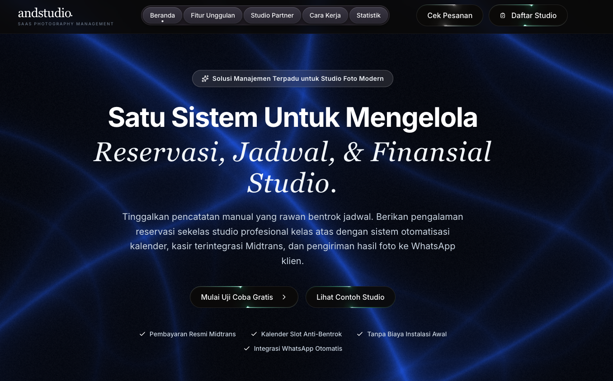

# AndStudio — Sistem Manajemen Reservasi Studio Foto

<p align="center">
  
</p>

> **SaaS manajemen operasional untuk studio foto** — reservasi jadwal, katalog paket, pembayaran otomatis Midtrans, notifikasi WhatsApp, dan distribusi hasil foto. Dibangun untuk UMKM studio foto di Indonesia.

---

## 📋 Overview

AndStudio adalah platform manajemen reservasi studio foto yang dirancang khusus untuk membantu pemilik studio foto mengelola bisnis mereka dengan lebih profesional. Platform ini terdiri dari **Laravel backend** (API + admin portal) dan **Next.js frontend** (landing page, katalog studio, dan halaman pembayaran).

Studio foto dapat mendaftar trial 14 hari, membuat paket foto, membuka jadwal reservasi, menerima pembayaran DP atau lunas melalui Midtrans, dan mengirimkan link download hasil foto ke klien via WhatsApp — secara otomatis.

---

## 🖼️ Screenshot / Tampilan

> Silakan tambahkan gambar screenshot di folder `docs/assets/` dan ganti path di bawah ini.

| Halaman | Preview |
|---------|---------|
| Landing Page | `docs/assets/landing.png` |
| Katalog Studio | `docs/assets/katalog.png` |
| Halaman Pembayaran | `docs/assets/bayar.png` |
| Dashboard Admin Studio | `docs/assets/dashboard.png` |

---

## 🚀 Fitur Utama

### Untuk Pelanggan (Frontend)
- **Katalog studio partner** — cari studio foto berdasarkan lokasi dan paket
- **Reservasi jadwal mandiri** — pilih paket, tanggal, waktu, dan add-on tanpa chat berulang
- **Pembayaran otomatis** — DP 30%, 50%, atau lunas via Midtrans (QRIS, VA, e-Wallet, transfer bank)
- **Notifikasi WhatsApp** — pengingat sesi H-1 dan link download hasil foto otomatis
- **Lacak pesanan** — cek status booking dan resi via nomor pesanan

### Untuk Pemilik Studio (Tenant Admin Portal)
- **Manajemen paket foto** — buat, edit, hapus paket dan add-on (cetak frame, fotografer tambahan, dll)
- **Kalender reservasi** — lihat semua booking, slot tersedia, dan jadwal bentrok
- **Manajemen pesanan** — lihat detail booking, status pembayaran, dan riwayat transaksi
- **Laporan finansial** — omset harian, piutang pelunasan, dan rekap kasir
- **Multi-staff** — pisahkan hak akses kasir, fotografer, dan pemilik studio

### Untuk Superadmin (Platform)
- **Manajemen studio tenant** — daftar, aktifkan/nonaktifkan studio
- **Review moderasi** — tinjau ulasan pelanggan dan request penghapusan
- **Webhook Midtrans** — verifikasi pembayaran secara otomatis

---

## 🛠️ Teknologi yang Digunakan

| Layer | Teknologi | Versi |
|-------|-----------|-------|
| Backend | Laravel | 11.x |
| Frontend | Next.js (App Router) | 16.4.6 |
| UI Styling | Tailwind CSS | v4 |
| Animasi | Motion (Framer Motion) | v14 |
| Icon | Lucide React | — |
| Payment Gateway | Midtrans (Snap) | — |
| Database | MySQL | — |
| Cache/Session | Database / File | — |
| Auth | Laravel Sanctum + Session | — |
| Language | PHP 8.5, JavaScript/TypeScript | — |

---

## 📁 Struktur Folder

```
andstudio/
├── app/
│   ├── Http/
│   │   ├── Controllers/
│   │   │   ├── API/              # Controller API publik (studio, booking, review, pesanan)
│   │   │   ├── Auth/             # Register, login, logout
│   │   │   ├── Superadmin/       # Kelola studio tenant, review moderasi
│   │   │   └── TenantAdmin/      # Dashboard studio, paket, pesanan, keuangan
│   │   └── Middleware/
│   │       └── DetectTenant.php  # Deteksi subdomain tenant
│   ├── Models/                   # Tenant, Studio, Package, Booking, Order, Review, dll
│   └── ...
├── bootstrap/
├── config/
├── database/
│   └── migrations/
├── frontend/                     # Next.js frontend (App Router)
│   ├── src/
│   │   ├── app/
│   │   │   ├── (pages)           # Halaman publik (/, /daftar, /faq, /tentang, dll)
│   │   │   ├── pesanan/          # Detail dan pembayaran pesanan
│   │   │   └── studio/[slug]/    # Katalog dan detail studio partner
│   │   ├── components/           # UI components reusable
│   │   ├── lib/
│   │   │   └── api.ts            # API wrapper dengan CSRF handling
│   │   └── ...
│   ├── next.config.ts
│   ├── package.json
│   └── tailwind.config.js
├── resources/
│   └── views/                    # Blade views (auth, admin layouts)
├── routes/
│   ├── web.php
│   └── api.php
├── storage/
├── .env                          # (diabaikan git — tidak di-commit)
├── .env.example                  # Contoh environment variables
├── artisan
└── composer.json
```

---

## 🖥️ Cara Penggunaan

### 1. Clone repository

```bash
git clone https://github.com/AWCODE13/ANDSTUDIO-WEB-SAAS.git
cd ANDSTUDIO-WEB-SAAS
```

### 2. Setup Backend (Laravel)

```bash
# Install dependency PHP
composer install

# Salin file environment
cp .env.example .env
# Edit .env sesuai kebutuhan (DB, APP_URL, SESSION, dll)

# Generate application key
php artisan key:generate

# Jalankan migration
php artisan migrate

# Jalankan seeder (jika ada)
php artisan db:seed

# Jalankan server development
php artisan serve
```

### 3. Setup Frontend (Next.js)

```bash
cd frontend

# Install dependency Node.js
npm install

# Salin file environment
cp .env.example .env.local
# Edit NEXT_PUBLIC_API_URL dan NEXT_PUBLIC_APP_URL

# Jalankan development server
npm run dev

# Build untuk production
npm run build
```

### 4. Variabel Penting (`.env` / `.env.local`)

| Variabel | Contoh | Keterangan |
|----------|--------|------------|
| `APP_URL` | `http://100.81.255.49:8000` | URL backend Laravel |
| `NEXT_PUBLIC_API_URL` | `http://100.81.255.49:8000/api` | Endpoint API untuk frontend |
| `NEXT_PUBLIC_APP_URL` | `http://100.81.255.49:8000` | Origin aplikasi utama |
| `NEXT_PUBLIC_MIDTRANS_CLIENT_KEY` | `SB-Mid-client-xxxx` | Client key Midtrans Sandbox |
| `DB_DATABASE` | `fotosync_saas` | Nama database |
| `SESSION_DRIVER` | `database` | Driver session Laravel |
| `SESSION_SECURE_COOKIE` | `false` | Aktifkan `true` di production HTTPS |

> ⚠️ File `.env` dan `.env.local` **tidak di-commit** ke GitHub. Buat sendiri sesuai environment Anda.

---

## 🔐 Keamanan

- CSRF token otomatis untuk semua request mutating (POST/PUT/PATCH/DELETE) via Laravel Sanctum + `X-XSRF-TOKEN` header.
- Midtrans webhook diverifikasi secara otomatis.
- Session cookie `HttpOnly`, `SameSite=Lax`.
- Hanya webhook Midtrans yang dikecualikan dari validasi CSRF.

---

## 🤝 Kontribusi

Pull request sangat diterima. Untuk perubahan besar, silakan buka issue terlebih dahulu untuk membahas apa yang ingin diubah.

1. Fork repository ini
2. Buat branch fitur (`git checkout -b fitur/nama-fitur`)
3. Commit perubahan (`git commit -m 'feat: tambah nama fitur'`)
4. Push ke branch (`git push origin fitur/nama-fitur`)
5. Buka Pull Request

---

## 📄 Lisensi

Proyek ini dilisensikan di bawah [MIT License](LICENSE).

---

## 👥 Kontak

Pertanyaan atau kerjasama: buka [Issue](https://github.com/AWCODE13/ANDSTUDIO-WEB-SAAS/issues) di repository ini.
